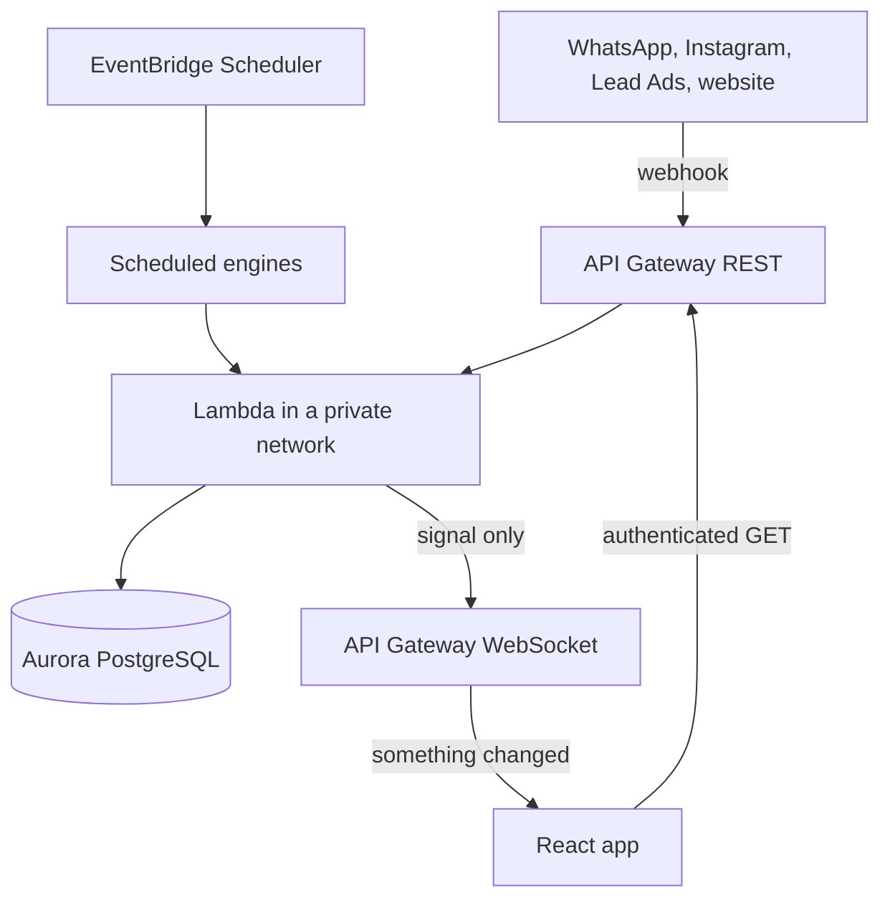

# Architecture

Apex AI runs entirely on AWS and is provisioned only through CDK. Nothing is created by hand in the console.

## How a message travels

1. A channel sends a webhook to a public route.
2. A Lambda stores the message and finds or creates the contact and the lead.
3. If an AI agent owns that number, it replies. If not, the lead goes to a person.
4. The WebSocket tells open screens that something changed.
5. The screen fetches the new data through the normal authenticated API.

## Main pieces

**Frontend.** A React single-page app served from S3 and CloudFront. The marketing site and blog are static Astro pages under the same distribution.

**API.** REST APIs behind a Cognito authorizer. Only webhooks, invitations, account recovery and the website form are public.

**Compute.** Lambda functions in private subnets, grouped into stacks by service, so a change to one area doesn't redeploy the rest.

**Scheduled engines.** Automations, the message queue, lead assignment and AI follow-ups run on EventBridge Scheduler. Each one authenticates through IAM, so no secret lives in a schedule.

**Data.** Aurora PostgreSQL holds the business data. Every table that belongs to a store is scoped to that store. Schema changes only happen through versioned migrations.

**Realtime.** A WebSocket API with a DynamoDB table of open connections.

## Environments and delivery

Development and production live in separate AWS accounts. A push to `dev` or `main` deploys to its environment through a self-hosted GitLab pipeline.

- Tests block the deploy that depends on them.
- Merge request pipelines run without cloud credentials, because they execute code nobody has reviewed yet.
- Features reach production one at a time, through curated cherry-picks.
